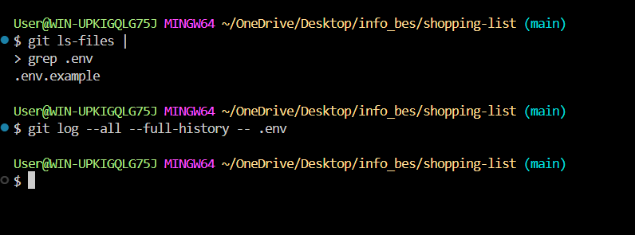
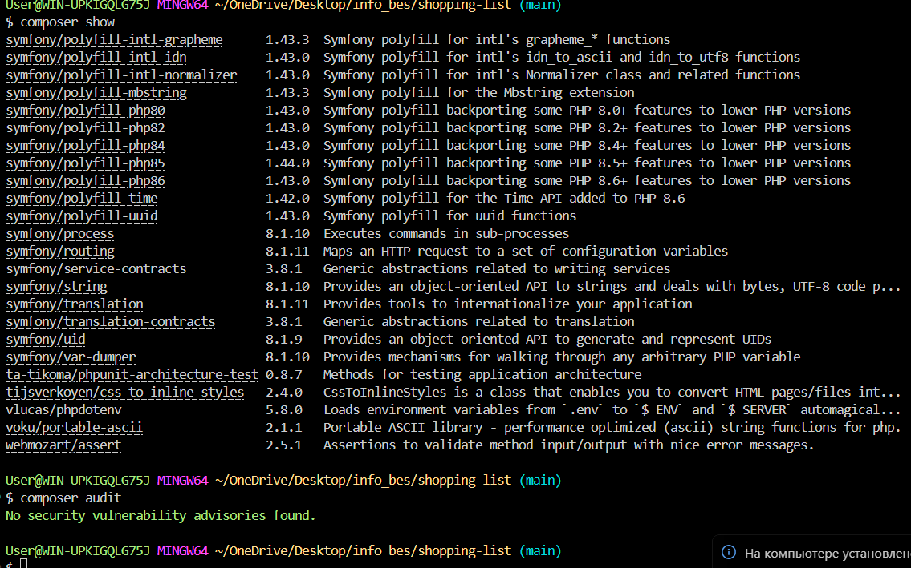
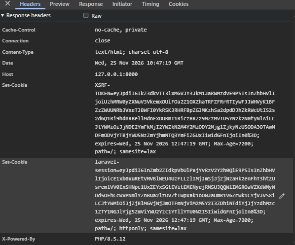
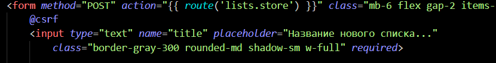
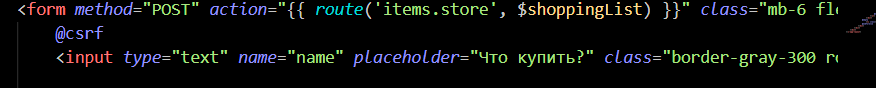
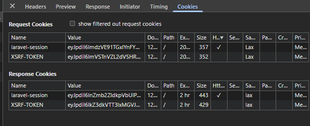
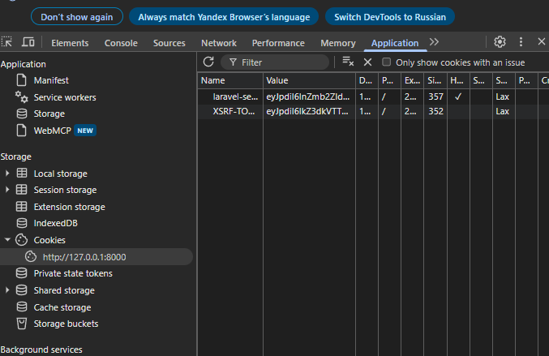

# Конфигурация безопасности (config-check.md)

Команда: 3, проект: shopping-list, стек: Laravel

## 1. Секреты (.env)
- **.env в .gitignore:** Да. Файл добавлен в `.gitignore` (строка 2).
- **В репозитории только .env.example:** Да. `git ls-files | grep .env` показывает только `.env.example`.
- **История Git:** Проверена командой `git log --all --full-history -- .env`. Совпадений не найдено, секреты в историю не попадали.

## 2. Зависимости
- **Список библиотек:** Laravel 13, Laravel Breeze, Tailwind CSS (через Vite), и другие. Полный список доступен по команде `composer show`.
- **Проверка уязвимостей:** Запущена команда `composer audit`. Результат: уязвимостей не обнаружено (`No security vulnerability advisories found`).
- **Обновления:** Все пакеты обновлены до актуальных версий. Задач по обновлению не требуется.

## 3. HTTPS и заголовки безопасности

**Проверка заголовков:**
Заголовки проверены через F12 -> Network -> Response Headers для главной страницы (`http://127.0.0.1:8000`).

**Обнаруженные заголовки (стандартные):**
- `Cache-Control`
- `Connection`
- `Content-Type`
- `Date`
- `Host`
- `Set-Cookie`

**Заголовки безопасности (отсутствуют на локальном сервере):**
- `Strict-Transport-Security` (HSTS) — отсутствует, так как нет HTTPS.
- `Content-Security-Policy` (CSP) — отсутствует.
- `X-Content-Type-Options` — отсутствует.
- `X-Frame-Options` / `frame-ancestors` — отсутствует.
- `Referrer-Policy` — отсутствует.

**Вывод:** На локальном сервере разработки (`php artisan serve`) заголовки безопасности не настроены. Для продакшена их необходимо добавить через middleware Laravel или конфигурацию Nginx. В рамках учебного проекта это не требуется, но зафиксировано в отчете как зона роста.

## 4. CSRF
- **Токены на формах:** Проверены файлы `lists/index.blade.php`, `lists/show.blade.php`, `profile/partials/update-profile-information-form.blade.php`. Во всех формах, меняющих данные, присутствует директива `@csrf`.

- **SameSite cookie:** В `config/session.php` установлено `'same_site' => 'lax'`.

## 5. Куки сессий

- **HttpOnly:** Да (проверено в F12 -> Application -> Cookies).
- **SameSite:** Lax (уже проверено в п. 4).
- **Secure:** Нет (на локальном сервере без HTTPS). На продакшене будет включено.

## 6. Самая опасная находка аудита зависимостей

По результатам `composer audit` критических уязвимостей в зависимостях не обнаружено (`No security vulnerability advisories found`). Все используемые пакеты (Laravel Framework, Breeze, Guzzle и др.) обновлены до актуальных версий.

Если бы уязвимость была найдена, самой опасной считалась бы та, которая позволяет выполнить произвольный код (RCE) или обойти аутентификацию. Поэтому рекомендуется регулярно запускать `composer audit` и обновлять зависимости.