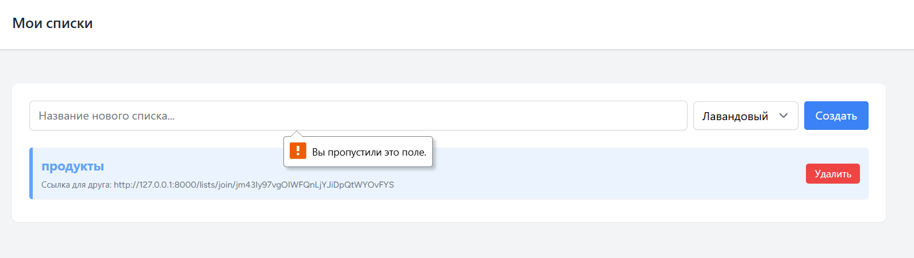
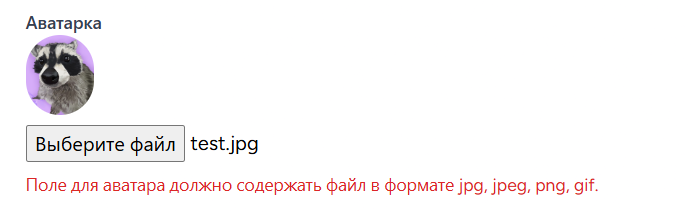

# Аудит входных данных (input-check.md)

Команда: 3, проект: shopping-list, стек: Laravel

## 1. Таблица всех форм проекта

| Страница | Поле | Тип (HTML) | Проверка на сервере (Laravel) | Длина / Диапазон |
| :--- | :--- | :--- | :--- | :--- |
| Регистрация (`/register`) | `name` | text | `required\|string\|max:255` | до 255 символов |
| Регистрация | `email` | email | `required\|string\|email\|max:255\|unique:users` | до 255 символов, формат email |
| Регистрация | `password` | password | `required\|string\|min:10` (настроено в `AppServiceProvider`) | минимум 10 символов |
| Вход (`/login`) | `email` | email | `required\|string\|email` | формат email |
| Вход | `password` | password | `required\|string` | — |
| Создание списка (`/lists`) | `title` | text | `required\|string\|max:255` | до 255 символов |
| Создание списка | `color` | select | `required\|string\|max:7` | hex-код (7 символов) |
| Добавление товара (`/lists/{id}/items`) | `name` | text | `required\|string\|max:255` | до 255 символов |
| Добавление товара | `category` | select | `required\|string\|max:255` | белый список (из кода) |
| Добавление товара | `priority` | select | `required\|string\|in:normal,desired,urgent` | белый список (из кода) |
| Профиль (`/profile`) | `name` | text | `required\|string\|max:255` | до 255 символов |
| Профиль | `email` | email | `required\|string\|email\|max:255\|unique:users` | до 255 символов, формат email |
| Профиль | `avatar` | file | `nullable\|file\|mimes:jpg,jpeg,png,gif\|max:10240` | до 10 МБ, только картинки |

## 2. Ссылка на коммит с серверной валидацией

Коммит: `(вставьте сюда хеш вашего последнего коммита)` — добавлена валидация для аватарки и всех форм.

## 3. Безопасная загрузка файлов (аватар)

Функция загрузки файлов реализована в профиле пользователя (`/profile`). Она соответствует пяти правилам:

| Правило | Реализация в Laravel |
| :--- | :--- |
| 1. Размер | `max:10240` (10 МБ) |
| 2. Тип по содержимому | `file` (Laravel проверяет MIME-тип, а не заголовок клиента) |
| 3. Расширение по белому списку | `mimes:jpg,jpeg,png,gif` |
| 4. Своё имя файла | `$request->file('avatar')->store('avatars', 'public')` (Laravel генерирует UUID) |
| 5. Хранение без исполнения | Файлы лежат в `storage/app/public/avatars`, доступ через `storage:link` |

**Тесты:**
1.  **Нормальная картинка:** Загрузили `test.jpg` — файл сохранился, аватарка отобразилась.
2.  **Поддельный файл:** Создали `shell.php`, переименовали в `shell.jpg`, попытались загрузить — Laravel выдал ошибку **422** «Файл должен быть изображением» (валидация `mimes` отклонила файл).

**Скриншоты отказов:** (приложите скриншот ошибки при загрузке `shell.php`).

## 4. Что считает сервер, а не принимает из запроса

В проекте реализован принцип «не доверяй клиенту»:
*   **Владелец списка (`user_id`):** Сервер берёт `Auth::id()`, а не поле из формы.
*   **Роль (`role`):** Сервер не принимает `role` из формы (её нет в `$fillable`). Роль назначается только через Tinker.
*   **Приоритет и категория:** Хотя они приходят из формы, сервер проверяет их через белый список (`in:...`), поэтому произвольную строку вставить нельзя.

## 5. Правила для нового кода

1.  **Всегда валидируйте данные на сервере** (через `FormRequest` или `$request->validate()`), даже если есть JS-валидация.
2.  **Для чисел указывайте диапазон** (`min`, `max`), для строк — длину (`max:255`), для статусов — белый список (`in:...`).
3.  **Для файлов используйте правило `file` + `mimes`**, храните их в `storage` (вне `public`), а имена генерируйте автоматически (через `store()`).

**Скриншоты отказов:**

