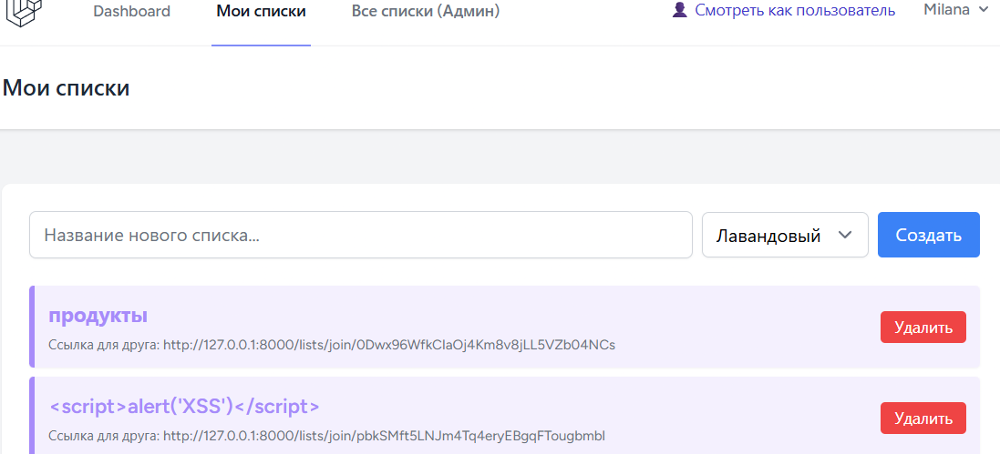
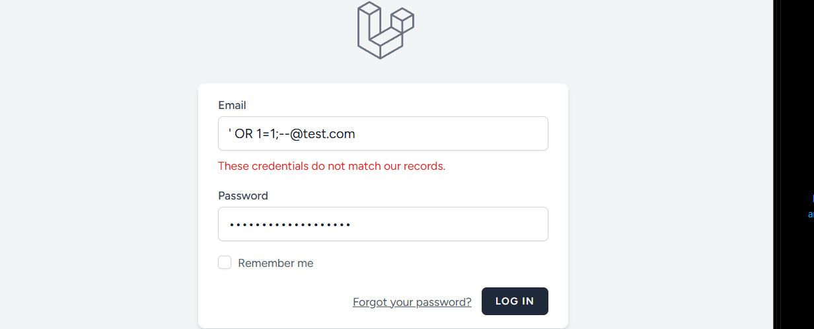
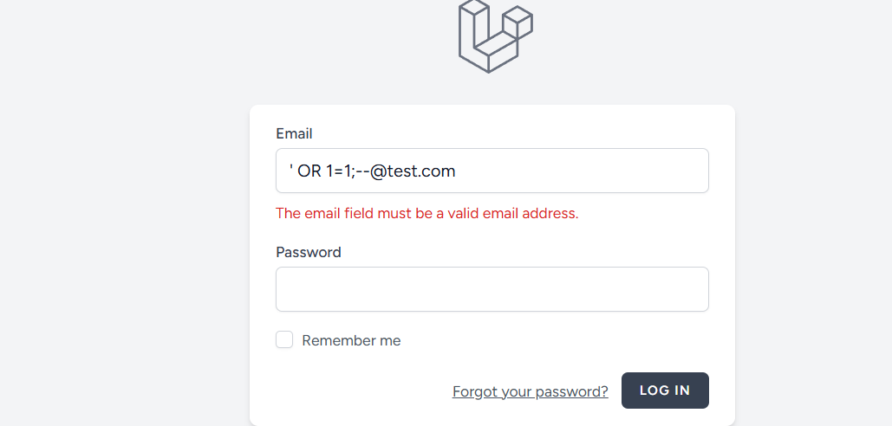

# Аудит безопасности: SQL-инъекции и XSS

Команда: 3, проект: shopping-list, стек: Laravel

## 1. Таблица мест работы с базой данных

| Файл | Строка | Как собирается запрос | Параметризован? |
| :--- | :--- | :--- | :--- |
| `app/Http/Controllers/ShoppingListController.php` | 28 (метод `store`) | `Auth::user()->shoppingLists()->create($data)` (Eloquent) | Да (ORM) |
| `app/Http/Controllers/ShoppingListController.php` | 66 (метод `show`) | `ShoppingList $shoppingList` (Route Model Binding) | Да |
| `app/Http/Controllers/ShoppingListController.php` | 18 (метод `index`) | `\App\Models\ShoppingList::where('user_id', auth()->id())->get()` | Да (Query Builder) |
| `app/Http/Controllers/ItemController.php` | 18 (метод `store`) | `$shoppingList->items()->create($data)` (Eloquent) | Да (ORM) |
| `app/Models/User.php` | 41 (метод `isAdmin`) | `$this->role === 'admin'` (свойство модели) | Да |

**Доказательство отсутствия SQL-инъекций:**
- В коде **нет** `DB::raw()`, `whereRaw()` или прямых строковых вставок переменных в SQL.
- Все запросы используют Eloquent ORM или Query Builder, которые автоматически экранируют параметры (prepared statements).

## 2. Таблица вывода пользовательских данных в шаблоны

| Файл | Строка | Что выводится | Экранируется? |
| :--- | :--- | :--- | :--- |
| `resources/views/lists/index.blade.php` | 32 | `{{ $list->title }}` | Да (Blade `{{ }}`) |
| `resources/views/lists/index.blade.php` | 36 | `{{ route('lists.join', $list->share_token) }}` | Да (Blade `{{ }}`) |
| `resources/views/lists/show.blade.php` | 34 | `{{ $item->name }}` | Да (Blade `{{ }}`) |
| `resources/views/lists/show.blade.php` | 43 | `{{ $category }}` | Да (Blade `{{ }}`) |
| `resources/views/lists/index.blade.php` | 28 | `style="background-color: {{ $list->color }}20;"` | Да (Blade `{{ }}`, но контекст CSS) |

**Доказательство отсутствия XSS:**
- В коде **нет** `{!! !!}` (вывод без экранирования).
- Все переменные выводятся через `{{ }}`, которые Laravel автоматически прогоняет через `htmlspecialchars()`.

## 3. Демонстрация атаки (ручная проверка)

**XSS (Cross-Site Scripting):**
- В поле «Название списка» ввели: ``.
- **Результат:** Скрипт не выполнился, на странице отобразился текст `` как обычный текст. Это доказывает, что Blade экранирует вывод.

**SQL-инъекция:**
- В поле email на странице входа ввели: `' OR 1=1;--@test.com`.
- **Результат:** Laravel выдал ошибку «The email field must be a valid email address». Это доказывает, что валидация отклонила подозрительный ввод ещё до попадания в базу данных. Дополнительно, все запросы в проекте используют Eloquent (prepared statements), поэтому даже при обходе валидации инъекция не сработала бы.

## 4. Правила для нового кода

1. **Всегда используйте Eloquent или Query Builder** для работы с базой данных. Никогда не вставляйте `$_GET` или `$request->input()` напрямую в SQL-строку.
2. **Всегда выводите данные в Blade через `{{ }}`**. Если нужен HTML (например, из визуального редактора), предварительно очищайте его через `Purify` или `strip_tags`.
3. **Не используйте `DB::raw()` без крайней необходимости**. Если используете — передавайте параметры через биндинги (`DB::raw('...', [$id])`).